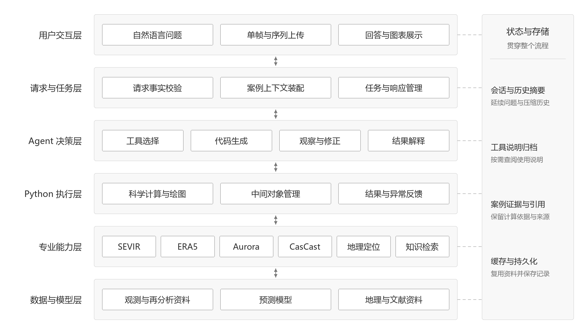
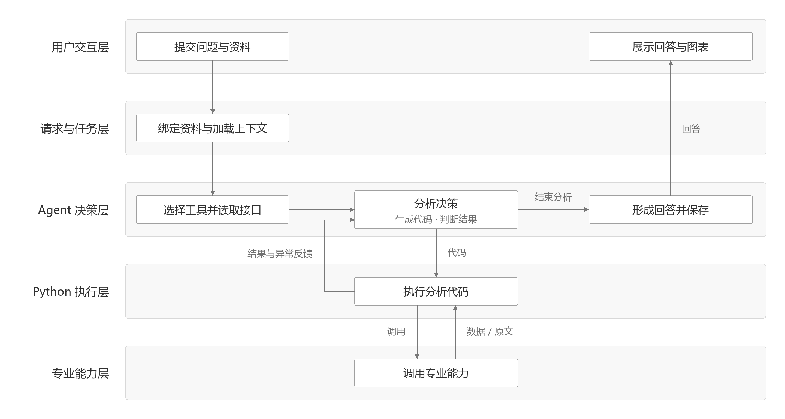
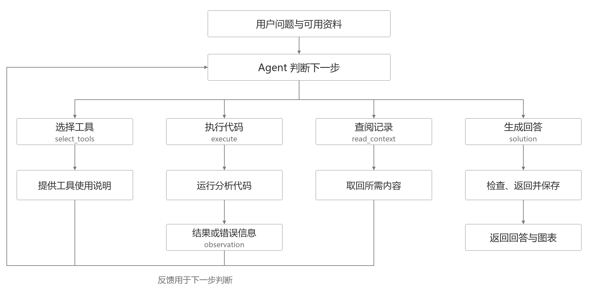
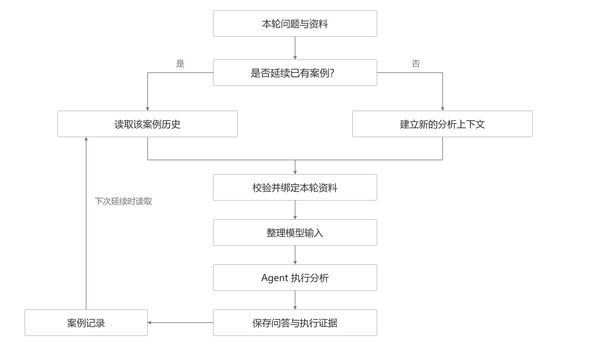
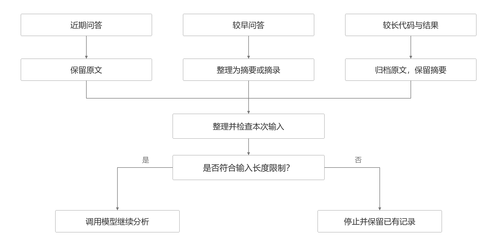

# 多源气象分析 Agent

本项目参考 Zephyrus 的气象科研 Agent 执行方式，围绕居民关心的天气问题，设计并实现多源气象工具接入、动态代码执行与多轮分析机制。系统结合通用大语言模型的问题理解与代码生成能力，以及专业数据、预测模型和知识资料，组织从问题输入到计算、解释和建议的分析过程。代码见

## 1 系统概述

### 1.1 系统目标

居民在安排出行和户外活动时，通常关心附近天气正在怎样变化、未来是否需要调整计划。回答这些问题需要结合不同尺度的观测和预测资料，而资料查询、模型运行与结果解释具有一定专业门槛。通用大语言模型能够理解日常表达，但针对具体地点和时刻作出判断，还需要实际数据、专业模型和领域知识支持。

为此，本项目参考 Zephyrus 的代码生成、工具执行和结果反馈机制，结合局地观测、集合预测与连续追问的需求，搭建面向居民的气象专用 Agent。用户通过自然语言提出问题，由 Agent 选择相关工具、获取资料并执行分析，再依据结果组织解释。通过结合通用模型的语言理解与任务组织能力，以及气象工具的计算能力和专业知识，降低用户直接操作数据与模型的难度。

系统希望将区域环境与局地天气联系起来，支持从大尺度到小尺度的天气分析，并结合未来预测和历史同期比较，为居民提供观测解释与生活安排参考。最终回答应说明判断依据和预测的不确定性，使用户能够理解当前天气、可能的变化，以及这些信息对出行等活动的影响。

### 1.2 主要功能

功能设计沿着从区域背景到局地天气、从已有观测到未来预测，再到历史同期比较展开。

| 分析内容 | 用户问题 | 资料与模型 |
| --- | --- | --- |
| 天气背景 | 当前气温、风场如何？ | ERA5 |
| 区域预测 | 未来 6 至 24 小时如何变化？ | Aurora |
| 局地观测 | 附近天气集中在哪、如何变化？ | SEVIR 多通道观测 |
| 短临预测 | 未来 5 至 60 分钟如何变化？ | CasCast 集合预测 |
| 历史同期比较 | 与往年同季节相比有何异同？ | 同区域、同季节的历史资料 |
| 生活建议 | 对出行、户外活动有何影响？ | 综合观测、预测和专业知识 |

跨尺度分析通过时间、地点和变量含义建立联系。例如，Aurora 用于提供区域环境预测，CasCast 用于描述局地短时演变，两类结果分别解释后再综合。历史同期比较提供所选资料范围内的参照，不直接等同于完整气候基准。

## 2 总体架构

### 2.1 模块组成

图 1 多源气象分析 Agent 分层架构。

- **用户交互层：** 接收自然语言和上传资料，展示分析进度、图表与回答。
- **请求与任务层：** 校验结构化输入、绑定资料、装配案例上下文，管理任务和结果提交。
- **Agent 决策层：** 选择工具、组织分析代码、观察反馈、修正行动并解释结果。
- **Python 执行层：** 运行生成代码，管理中间对象，返回统计、图像和异常信息。
- **专业能力层：** 提供观测读取、再分析资料、区域预测、局地预测、地理定位和知识检索接口。
- **数据与模型层：** 提供实际观测、再分析文件、模型资产、地理资料和专业文献。

### 2.2 工作流程

图 2 一次任务的执行与反馈流程。

1. **接收问题并整理事实。** 校验上传资料、显式选择与案例继承条件，将请求送入统一 Agent。
2. **选择能力并读取说明。** 先提供简短目录，再按选择补充接口签名、参数和返回字段；需要时回读完整说明。
3. **生成代码并调用工具。** 在 Python 环境中获取数据、运行预测、进行统计或绘图。
4. **依据反馈继续执行。** 检查结果和异常，复用已保留对象，修正代码或补充资料。
5. **返回并保存。** 汇总计算与原文依据，生成回答和图表，保存过程记录；未完成部分单独说明。

### 2.3 公共支持能力与章节安排

上下文和执行证据属于图中贯穿各层的状态与存储支持。上下文帮助 Agent 理解“用户前面在问什么”，执行证据保留“实际调用了什么、得到了什么结果”。第四章说明回答返回时如何关联保存执行依据，第五章说明历史问答如何延续和压缩。预测数组和图表等文件由相应缓存或产物目录保存，案例记录保留查找这些资料所需的标识。

应用流程与运行管理主要由用户交互层、请求与任务层负责，并与 Agent 和 Python 执行层协作。第四章说明 Agent 的行动与反馈，第五章说明上下文管理，第六章按六层结构说明新模型的接入流程，第七章总结架构优势，第八章归纳运行问题，第九章说明已完成内容与后续工作。

## 3 工具接入

Agent 通过 Python 接口读取数据、运行模型和检索文献。返回结果保留时间、坐标、单位和来源，供后续计算与解释。

### 3.1 SEVIR 观测

按地点、时间或事件查找 VIL、可见光、红外和闪电观测，用于分析天气分布与连续变化。支持单通道和多通道读取，也可以将上传的 VIL 图片或序列匹配到目录事件。

### 3.2 历史分析

筛选同一区域、相近季节的历史事件，批量读取观测进行比较。也可以按强度、范围、演变和移动等特征查找相似事件，给出相似程度排序和主要差异。

### 3.3 ERA5 数据获取

按变量、时间和区域获取再分析资料，提供可直接计算的气象场，用于了解区域天气背景、开展历史统计和验证预测。支持查询数据集与变量，已下载资料可以复用。

### 3.4 Aurora 区域预测

使用起报时刻及此前六小时的 ERA5 资料构建输入，每六小时向后预测一步。输出区域气象场，用于分析未来温度、风速等变化。

### 3.5 CasCast 短临预测

输入为间隔五分钟的 13 帧 VIL，单次预测未来 5 至 60 分钟的 12 帧结果，返回各集合成员及均值，用于分析局地天气演变和预测差异。

支持滚动预测至三小时，后续小时使用前一小时的集合均值继续推算。可以读取已有预测产品，也可以运行模型生成新预测。

### 3.6 地理定位

支持地名解析、行政边界查询、经纬度与观测像素互转，以及区域掩膜和裁切。用于确定城市或区域的位置，并从气象资料中选取对应范围的数据。

### 3.7 知识检索

从已入库的气象数据和模型资料中查找原文，采用 BGE-M3 语义检索、BM25 关键词检索和本地重排。检索结果附原文片段、出处和引用标记，支持回读完整片段，为专业解释提供资料依据。

## 4 Agent 执行机制

Agent 按“生成代码、执行、读取结果、继续分析”的循环工作。每轮可以选择工具、执行代码、查阅记录或提交回答；程序通过 `observation` 返回计算结果和错误，供 Agent 决定下一步。

图 3 Agent 行动与反馈链路。

### 4.1 选择工具（select_tools）

系统先提供工具名称和用途，Agent 通过 `select_tools` 选择所需能力，再获取参数、返回字段等调用说明。完整说明可用 `read_context` 回读，分析过程中也可以补选工具。

### 4.2 执行代码（execute）

Agent 通过 `execute` 提交 Python 代码，由独立进程 Worker 运行。同一请求内，后续代码可以继续使用已成功保存的变量；普通变量先在副本中修改，整步成功后再保存。

| 步骤 | 处理方式 | 输出 |
| --- | --- | --- |
| 提交代码 | Agent 编写取数、计算和绘图代码 | 待执行程序 |
| 执行检查 | 检查语法和导入库 | 通过或返回错误 |
| Worker 运行 | 在变量副本中执行，监控耗时、内存和取消信号 | 计算结果、调用记录和图表 |
| 保存变量 | 整步成功后保存变量 | 供后续步骤复用 |
| 返回反馈 | 汇总结果、可用数据和错误位置 | 供 Agent 继续分析或回答 |

每步结果通过 `observation` 返回，包括计算值、图表、错误位置和可复用数据。Agent 据此继续分析，或修改代码后重试。

| 执行情况 | 反馈内容 | 后续处理 |
| --- | --- | --- |
| 成功但信息不足 | 已有结果与可用变量 | 补充分析或资料 |
| 调用或计算出错 | 错误类型、位置及可用数据 | 修正代码，复用有效数据 |
| 取数成功，后处理失败 | 调用记录与数据保留状态 | 取回保留数据，或从缓存重读 |
| 重复已成功的知识检索 | 已有原文与归档入口 | 拦截重复调用，回读已有资料 |

系统限制调用次数、连续错误和总耗时。达到限制后，使用已有结果生成回答，并说明未完成内容。

### 4.3 查阅记录（read_context）

通过 `read_context` 查阅历史问答、执行记录、资料来源和工具说明。例如，比较“刚才的预测”时，先查原事件和有效时刻，再读取对应观测进行计算。

### 4.4 生成回答（solution）

Agent 通过 `solution` 提交回答，解释计算结果并引用相关资料。系统将文字与图表一起返回，并检查执行状态、图表和引用。

| 检查项 | 检查依据 | 异常处理 |
| --- | --- | --- |
| 执行状态 | 最近一步是否成功 | 失败则标记部分完成 |
| 图表 | 要求的图表是否已生成 | 缺图则标记部分完成 |
| 引用 | 引用能否对应原文 | 遗漏时尝试补充一次；无法解析则标记部分完成 |

本轮问答、调用参数、计算结果、图表和来源一并保存。后续追问按记录查找原条件，再从工具或缓存读取实际数据。

## 5 上下文管理

### 5.1 会话记忆

同一分析任务的问答和执行记录按案例保存。请求指定继续已有案例时，加载原问题、事件、参数和结果；新任务建立新的分析记录，供后续追问使用。

### 5.2 历史压缩

近期问答尽量保留原文，较早内容整理为摘要；较长的代码、结果和工具说明归档，按需回读。

| 内容 | 送入模型 | 保存方式 |
| --- | --- | --- |
| 近期问答 | 预算内保留原文 | 完整问答按轮次保存 |
| 较早问答 | 目标、条件、结果、纠正和待办摘要 | 关联历史轮次，支持回读 |
| 长代码与反馈 | 状态摘要、可用数据和回读入口 | 代码与反馈成对归档 |
| 工具说明 | 简版用法 | 完整说明归档，按需回读 |

摘要保留任务目标、关键条件、已有结果、用户纠正和待办。每次调用模型前检查输入长度，超出限制时先压缩；仍超限则停止调用并保留已有记录。

## 6 新模型接入系统

接入新模型，需要完成模型运行、接口封装、Agent 调用和网页展示，具体按以下六层处理。

### 6.1 数据与模型层

准备运行环境、权重和输入数据，先让模型独立完成一次预测。明确输入输出的变量、单位、时间间隔和空间范围。

### 6.2 专业能力层

封装 Python 接口，写清参数和返回字段。输出整理为可直接计算的数组、表格或数据集，附上时间、坐标和单位。

### 6.3 Python 执行层

让 Worker 能调用模型接口，配置解释器、设备、时间和内存限制，并返回模型结果和错误信息。

### 6.4 Agent 决策层

将模型加入工具目录，说明适合回答什么问题、需要什么输入。Agent 选中后获取接口说明，生成代码完成调用和分析。

### 6.5 请求与任务层、用户交互层

接好资料上传和参数输入，将模型调用纳入任务、进度与取消流程。按输出特点展示文字、图表或动画，标明时间和区域。

### 6.6 状态与存储支持

保存模型版本、输入、参数和结果来源，缓存相同条件下的预测。最后检查从提问、模型调用到结果展示和连续追问的完整流程。

## 7 Agentic AI 架构的优势

- **能够围绕问题组织分析：** Agent 根据用户目标选择工具、生成计算代码，并结合中间结果决定下一步。同一组数据与模型可以用于不同的统计、比较和追问任务，减少为每种问题单独编写固定流程的需要。
- **支持多种专业能力协作：** 数据读取、预测、定位和知识检索通过接口进入同一分析环境。Agent 可以围绕地点、时间和变量组织这些能力，将区域背景、局地演变和专业解释联系起来。
- **能够依据反馈继续计算：** `execute` 的实际结果通过 `observation` 返回，Agent 可以据此补充分析或修改代码，再通过 `solution` 形成回答。分析过程因而可以随实际取得的数据逐步调整。
- **便于扩展和替换模型：** 模型运行与工具接口分别由对应层负责，上层复用工具选择、代码执行、任务管理和结果展示流程。新增模型时，可围绕其输入输出要求完成适配，使其参与已有分析任务。
- **支持连续追问与结果追溯：** 会话记录保留任务联系，执行记录保留数据来源、模型条件和计算结果。用户能够在已有分析上继续提问，开发者也能沿记录核查回答的依据。

## 8 当前问题与提升方向

结合实际运行中出现过的问题，后续可能的改进有以下几点。

### 8.1 减少重复调用和无效分析

**待改进问题：** 实际运行中曾出现资料已经检索成功，却继续执行相同查询的情况。已有缓存和重复检索限制，还需进一步减少复杂任务中的重复取数和无效步骤。

**希望提升：** 让 Agent 更好地利用已有结果，只在缺少必要信息时继续调用工具，缩短用户等待时间。

### 8.2 提高多步分析中的数据复用稳定性

**待改进问题：** 前一步取得的数据，需要在后续步骤中正确引用。虽然已有变量保存和对象恢复机制，仍需让 Agent 准确判断哪些数据可以直接使用、哪些需要重新读取。

**希望提升：** 加强步骤之间的数据衔接，使较长的分析任务能够在已有结果上继续计算，减少中途重复处理。

### 8.3 提高错误恢复效率

**待改进问题：** 实际运行中曾出现多次修改代码，但没有解决真正原因的情况。接口使用错误、数据未恢复和计算方法错误，需要采取不同的处理方式。

**希望提升：** 提供更清楚的错误与可用数据反馈，帮助 Agent 尽快找到问题所在，并保留已成功完成的工作。

### 8.4 改善长对话的信息保留

**待改进问题：** 连续追问会积累较多历史内容。压缩时既要控制输入长度，也要保留事件、时间、参数和结果来源，方便后续问题继续分析。

**希望提升：** 优化摘要与回读方式，优先保留当前任务需要的关键条件，减少反复整理历史和查找资料的开销。

### 8.5 优化多模型运行的资源开销

**待改进问题：** CasCast、Aurora 和知识检索模型涉及不同的运行环境与加载过程，共享计算资源时还需要协调执行顺序。

**希望提升：** 结合实际耗时和显存占用优化模型加载、结果缓存及任务调度，减少重复加载和资源等待。

## 9 已完成内容与后续工作

目前已接通从自然语言提问、获取气象数据、调用预测模型，到执行计算、生成图表和回答的流程。接下来要把这些功能完善成响应及时、分析稳定、结果清楚的气象 Agent Demo。

### 9.1 响应速度

**已完成：** 已记录 LLM 调用、数据读取和代码执行的耗时，部分数据和预测结果可以从缓存复用。

**还需完成：** 找出完整回答中最耗时的步骤，减少模型重复加载、重复取数和不必要的分析。分别测量首次运行和使用缓存时的速度，明确常见问题需要多久才能答完。

### 9.2 问题理解与分析决策（policy）

**已完成：** LLM 能选择工具、生成代码，并根据运行结果继续分析。目前用什么模型、怎样分析、什么时候结束，主要由 LLM 判断。

**还需完成：** 提高对模糊问题的理解和分析能力。例如用户问“下午适合出门吗”，系统应先明确地点、时间和关注的天气因素，再选择合适的数据、预测模型和分析方法。分析中持续检查还缺什么、是否已回答用户问题，减少无效调用和过早结束。

### 9.3 工具说明与调用

**已完成：** 工具以 Python 接口接入。Agent 先选择工具、读取说明，再生成调用代码；完整说明可以回读。但多步分析中仍会遗漏参数要求，重复尝试错误用法。

**还需完成：** 改进说明的提供和保留方式，让关键参数、返回字段及已成功的调用方式在后续步骤中仍然可用。出错时先核对接口和已有结果，再修改代码，减少猜参数和同一错误反复重试。

### 9.4 数据获取与模型输入准备

**已完成：** 已支持 SEVIR 观测检索、VIL 图片或序列上传、ERA5 下载，以及 CasCast 和 Aurora 的输入适配；地理工具能解析地点和选取行政区域。

**还需完成：** 根据地点和时间自动找到所需观测、检查是否缺帧，并准备预测输入。将区域资料与局地观测的时间、位置对应起来，减少人工整理和调用前的反复确认。

### 9.5 计算结果与回答一致

**已完成：** 已支持统计、趋势分析、绘图和预测与实况对比，计算由实际运行的 Python 代码完成。

**还需完成：** 核对指标的计算方法，统一单位、时间范围和区域范围。让回答中的数字、表格和图表逐项对应计算结果，解决计算结果与最终表述不一致的问题。

### 9.6 分清实际分析与 LLM 已有知识的贡献

**已完成：** 已保存工具调用、输入参数、计算结果、图表和文献引用，可以查看系统实际做了哪些操作；目前还没有明确区分实际分析带来的提升与 LLM 本身的知识能力。

**还需完成：** 将关键结论对应到具体数据和计算。使用同一个 LLM，对比直接回答、提供正确计算结果后回答、Agent 自主取数分析三种情况；再更换输入数据，检查结论是否随实际结果变化，判断工具与计算带来了多少帮助。

### 9.7 图表展示

**已完成：** 网页能展示分析图表，Agent 可以生成统计图、空间分布图和预测与实况对照图。

**还需完成：** 统一图表样式、时间标注、单位和色标，改善 LLM 生成图表时布局不统一、信息不清楚的问题。补充适合不同任务的图表和连续动画，使天气变化与预测差异更直观。

### 9.8 实时反馈与交互

**已完成：** 网页已能显示任务状态、执行步骤和耗时，并支持取消任务。

**还需完成：** 将执行记录整理为用户能读懂的进度说明，持续展示正在读取什么数据、已经完成什么、下一步做什么。逐步展示已有图表和阶段结果，明确哪些信息直接呈现、哪些细节供展开查看，让等待和分析过程更清楚。

### 9.9 天气解释与生活建议

**已完成：** 系统能够结合分析结果生成天气解释，以及出行、户外活动等建议，并附上资料来源。

**还需完成：** 为“增强”“接近”“需要关注”等判断提供明确的计算依据，写清对应地点和时段。建议需要说明由哪些观测或预测结果得出，使用户能理解为什么建议调整安排。

### 9.10 连续追问

**已完成：** 已保存对话、资料来源和计算结果，支持延续已有分析。较长历史会整理成摘要，详细记录可以回读。

**还需完成：** 用户修改地点、时间或上传资料后，及时更新分析条件，判断哪些结果能复用、哪些需要重算。长对话中保留用户纠正和关键结果，避免追问时用错事件或沿用旧结论。

### 9.11 缺少信息与运行失败的处理

**已完成：** 已有参数检查、错误反馈和部分完成状态。运行失败后，Agent 可以依据错误及已保留的数据修改代码，继续执行。

**还需完成：** 缺地点、时间或观测时，明确提示需要补充什么，并在补充后继续。分别处理下载失败、模型不可用和代码错误，保留已完成的工作，清楚说明当前结果和未完成部分。

## 参考文献与资源

| 对应内容 | 来源 |
| --- | --- |
| Agent 执行思路 | [Zephyrus，ICLR 2026](https://arxiv.org/abs/2510.04017) |
| SEVIR 观测数据 | [SEVIR，NeurIPS 2020](https://papers.nips.cc/paper_files/paper/2020/hash/fa78a16157fed00d7a80515818432169-Abstract.html) |
| ERA5 再分析资料 | [The ERA5 global reanalysis，QJRMS 2020](https://doi.org/10.1002/qj.3803) |
| CasCast 短临预测 | [CasCast，ICML 2024](https://proceedings.mlr.press/v235/gong24a.html) |
| CasCast 中的 Earthformer | [Earthformer，NeurIPS 2022](https://proceedings.neurips.cc/paper_files/paper/2022/hash/a2affd71d15e8fedffe18d0219f4837a-Abstract-Conference.html) |
| Aurora 区域预测 | [Aurora，Nature 2025](https://doi.org/10.1038/s41586-025-09005-y) |
| BGE-M3 文献检索 | [M3-Embedding，Findings of ACL 2024](https://aclanthology.org/2024.findings-acl.137/) |
| 文献重排模型 | [BAAI/bge-reranker-v2-m3](https://huggingface.co/BAAI/bge-reranker-v2-m3) |

论文 BibTeX 见 [references.bib](docs/references.bib)。运行所需的数据、模型权重与行政边界准备方法见[数据与模型准备](docs/DATA_AND_MODELS.md)。
