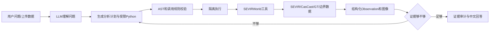

# SEVIR Agentic AI Demo：组会汇报框架

> 本文不是项目功能说明书，而是后续制作组会 PPT 的内容底稿。汇报目标是讲清楚：为什么做、借鉴了什么、我具体做了什么、目前有什么证据、遇到了什么困难，以及哪些问题尚未解决。

## 0. 汇报口径

### 一句话介绍

我将 CasCast 的短临降水集合预测能力，接入一个参考 Zephyrus 执行范式构建的气象 Agent，使普通用户可以用自然语言上传和分析 SEVIR VIL 数据，并获得有数据依据、可追溯、能说明不确定性与局限的回答。

### 不应该说成什么

- 这不是一个新的天气预测模型；核心预测模型来自 CasCast。
- 这不是 Zephyrus 的完整复现；我借鉴的是 Agent 与工具环境的组织方式。
- 这不是灾害预警系统；当前处理的是 SEVIR 编码 VIL，不等同于降雨量、dBZ、冰雹、洪水或官方危险等级。
- 这不是已经完成的大规模模型评测；当前定量结果只来自本地 10 个测试事件。

### 建议汇报主线

> 从“模型能生成预测”走到“普通用户能围绕一次天气过程连续提问，Agent 自己选择证据、计算、画图，并说明结论边界”。

---

## 1. PPT 总体结构

建议 12 页正文，控制在 15～20 分钟。不要按代码模块逐一介绍，而要围绕一个问题逐层展开。

| 页码 | 标题 | 这一页只回答一个问题 |
|---:|---|---|
| 1 | 题目与一句话目标 | 我做的到底是什么？ |
| 2 | 问题来源 | 为什么单独有预测模型还不够？ |
| 3 | 两项参考工作 | CasCast 和 Zephyrus 分别给了我什么？ |
| 4 | 我的系统边界 | 哪些是借鉴，哪些是我的实现？ |
| 5 | 系统调用链 | 一个问题如何变成可核验的回答？ |
| 6 | CasCast 接入 | 真实预测数据怎样进入 Agent？ |
| 7 | 从固定任务到动态分析 | Agentic 体现在哪里？ |
| 8 | 我做的关键改进 | 相比最初版本，系统具体改了什么？ |
| 9 | Demo 故事线 | 组会上如何连续演示，而不是罗列工具？ |
| 10 | 当前结果与证据 | 现在实际做到什么程度？ |
| 11 | 遇到的困难 | 哪些问题真正花了时间，为什么难？ |
| 12 | 未解决问题与下一步 | 目前还不能回答什么？下一步先做什么？ |

附录建议保留 3～4 页：工具表、指标定义、测试与失败样例、老师可能追问的问题。

---

## 2. 各页内容

### 第 1 页：题目与一句话目标

**建议标题：** 面向 SEVIR 短临天气分析的 Agentic AI Demo

**副标题：** 连接自然语言、真实气象数据、CasCast 预测与可追溯分析

**这一页讲：**

- 输入可以是自然语言问题、单张 VIL 图或过去一小时的 13 帧 VIL 序列。
- Agent 根据问题调用数据、预测、不确定性、评价、地理定位和可视化工具。
- 输出不是只有聊天文本，而是计算结果、预测图、指标、证据来源和限制说明。

**不要放：** 大段背景、Agentic AI 定义、行业愿景。

---

### 第 2 页：问题来源

**核心问题：预测模型有输出，但普通用户仍然难以使用。**

CasCast 能生成未来 VIL 序列，但模型输出本身不能自动回答：

- 过去一小时天气是在增强、减弱，还是主要发生了移动？
- 未来最值得关注的是哪个时段、哪个区域？
- 10 个 ensemble 成员的差别在强度、位置还是范围？
- 预测与 Ground Truth 相比表现如何？
- 证据不足时，哪些话不能说？

因此，本项目解决的不是“再训练一个模型”，而是预测模型之外的最后一段链路：

```text
自然语言问题
→ 选择数据和工具
→ 运行计算或预测
→ 检查证据是否足够
→ 生成合适图表
→ 给出有边界的解释
```

---

### 第 3 页：从 CasCast 和 Zephyrus 借鉴了什么

#### 3.1 从 CasCast 借鉴的内容

CasCast 提供的是**天气预测能力和数据处理链路**：

- 使用 SEVIR VIL 数据，输入过去 13 帧，输出未来 12 帧，即过去 60 分钟到未来 60 分钟，每 5 分钟一帧。
- 采用级联思路：EarthFormer 先给出确定性背景场，Autoencoder 压缩到 latent 空间，CasFormer 扩散采样补充概率性和小尺度结构，再解码回 VIL 场。
- 不同随机种子可生成多个未来成员，为不确定性分析提供基础。
- 使用 Persistence 作为必要基线，用“最后一帧保持不变”检验复杂模型是否真的提供了增益。

**我没有声称的内容：** 没有改动 CasCast 网络结构、损失函数或训练方法，也没有把本项目称为新的 nowcasting 模型。

#### 3.2 从 Zephyrus 借鉴的内容

Zephyrus 提供的是**Agent 的执行范式**：

- 将 LLM 与一个受控的天气科学工具环境连接，而不是只依赖模型记忆回答。
- Direct 模式：一次生成一个完整分析程序，适合边界明确的问题。
- Reflective 模式：执行、观察结果、判断证据是否足够，再继续补充分析。
- 让 Agent 编写和执行 Python 分析代码，动态组合数据和工具。
- 记录工具调用与 Observation，便于检查回答依据。

#### 3.2.1 Zephyrus 架构具体是什么

Zephyrus 不是一个单独的天气预测模型，而是把 LLM 放在一个可执行的天气科学环境中。它的核心组件可以按四层理解：

| 层次 | Zephyrus 中的组件 | 作用 |
|---|---|---|
| 用户任务层 | 自然语言问题、ZephyrusBench 任务 | 描述要回答的天气科学问题 |
| Agent 层 | Zephyrus-Direct / Zephyrus-Reflective | 选择工具、编写分析程序、根据结果决定是否继续 |
| 执行环境层 | ZephyrusWorld、Python API、代码执行服务器 | 提供受控的数据访问、预报、模拟、气候统计和地理工具 |
| 数据与模型层 | WeatherBench 2、Natural Earth、Stormer、模拟器等 | 提供 Agent 计算所需的真实数据和专业模型 |

它与普通“LLM + 函数调用”的差别在于：函数不是针对每个问题提前写好完整答案，而是给 Agent 提供可组合的专业原语。Agent 可以生成一段分析代码，例如先筛选时间范围，再按区域分组，计算自己需要的统计量，执行后读取 Observation，发现证据不足时继续调用工具。

两种运行方式的区别是：

- **Direct：** LLM 一次生成完整程序，执行后直接组织答案；速度较快，适合“查询一个事件的最大值”这类目标明确的问题。
- **Reflective：** LLM 采用“生成程序 → 执行 → 观察结果 → 判断是否需要下一步”的循环；适合“比较多个事件、解释异常、结合预测和历史背景”这类需要调查过程的问题。

可以把 Zephyrus 的关键思想概括为：

```text
问题不是直接交给 LLM 凭记忆回答
而是交给 LLM 规划一段可执行的分析
→ 在专业数据环境中执行
→ 读取真实结果
→ 必要时继续调查
→ 根据证据回答
```

**这对我最重要的启发：** Agent 的“智能”不只是生成更长的文字，而是能够根据问题改变数据选择、统计量和工具组合，并让回答回到真实 Observation 上。

#### 3.2.2 我如何把 Zephyrus 迁移到 SEVIR 场景

Zephyrus 的 `ZephyrusWorld` 不能直接拿来使用，因为它的数据、模型和任务都是 WeatherBench 2 体系。本项目重新实现了对应的 SEVIRWorld：

| Zephyrus 的抽象 | 本项目的替代实现 |
|---|---|
| 天气数据 API | SEVIR CATALOG、HDF5 VIL 事件、上传图片/序列 |
| 预报工具 | CasCast、Persistence baseline |
| 气候/历史查询 | CATALOG 元数据和历史事件统计 |
| 地理工具 | SEVIR 投影到经纬度，再匹配州县边界 |
| 模拟/结果分析 | VIL 阈值、连通区域、storm-object、ensemble 分歧 |
| 图表输出 | 预测序列、成员对比、共识/不确定区、指标图 |
| 执行服务器 | 受限 Python worker、AST 校验、时间/内存/调用预算 |

因此我的关系不是“复现 Zephyrus”，而是借鉴它的接口思想和执行循环，将底层世界模型替换为 SEVIR/CasCast，并针对气象短临预测增加了 GT 对齐、预测时效、不确定性和科学结论边界。

#### 3.2.3 借鉴边界

**参考了：** LLM 编程、工具环境、Direct/Reflective 两种循环、execute-observe-refine、代码执行服务器和 benchmark 思路。

**没有复现：** WeatherBench 2 数据管线、Natural Earth 全部工具、Stormer/JAX 模拟器、ZephyrusBench 的 49 类任务，也没有声称达到论文中的整体性能提升。

**我新增的约束：** SEVIR VIL 不是降雨量；ensemble 支持率不是校准概率；没有 GT 时不能计算准确率；2～3 小时滚动预测必须保留真实时效和真值覆盖信息。这些约束是迁移到本项目后，根据 CasCast 输出和 SEVIR 数据特点补上的。

#### 3.3 两项参考工作的关系

| 层次 | CasCast | Zephyrus | 本项目中的作用 |
|---|---|---|---|
| 专业模型 | 短临降水预测 | 可接入天气预报/模拟工具 | CasCast 作为 Agent 的预测工具 |
| 数据 | SEVIR VIL | WeatherBench 2 等 | 聚焦 SEVIR VIL 与本地 HDF5 |
| 不确定性 | 扩散采样可产生多成员 | Agent 可调用工具分析结果 | 保留 10 个成员并分析分歧 |
| 交互方式 | 脚本式推理 | LLM 生成代码并执行 | 多轮网页对话和动态图表 |
| 研究重点 | 提高预测技巧 | 提高天气任务求解能力 | 研究模型结果如何被 Agent 使用和约束 |

---

### 第 4 页：哪些是我的思考与实现

这一页必须用第一人称讲清楚贡献边界。

1. **我重新定义了目标用户和任务。** 不是让气象专家输入固定指标名，而是让普通用户说“这片天气在变强还是移动”“这些预测差别大吗”。
2. **我把 CasCast 从离线推理脚本封装成 Agent 可调用工具。** Agent 可以读取保存的 10 路 ensemble，也可以对本地 HDF5 事件或上传的 13 帧序列进行现场推理。
3. **我把固定问答改成动态分析。** Agent 能发现字段、筛选记录、选择统计量、编写受限 Python，再根据 Observation 决定是否继续。
4. **我把 ensemble 从“展示平均图”改成“保留成员差异”。** 当前计算 mean、pixel-wise std、Q10/Q90、阈值成员支持率，以及对象中心和范围差异。
5. **我加入了证据与结论边界。** 系统区分观测、预测和推断；没有 GT 时禁用准确率表述；成员比例不直接写成灾害概率。
6. **我补齐了面向 Demo 的交互链路。** 支持单张/13 帧上传、多轮会话、完整逐时效图像、技术调用记录和生成图表展示。
7. **我加入了可重复检查。** 用回归测试、13 轮连续对话和针对失败轮次的复测检查系统，而不是只挑一次成功回答截图。

**建议页脚放一句：** 我的工作重点不是提高 CasCast 的预测精度，而是让预测结果在 Agent 中可调用、可分析、可解释、可追溯，并且不越过数据能支持的结论。

---

### 第 5 页：系统调用链



**讲述重点：**

- LLM 不直接读本地文件，也不能任意访问系统、网络或导入模块。
- Agent 生成的代码只能调用注入的 `ds`、`forecaster`、`statistics`、`uncertainty`、`metrics`、`geolocator`、`visualizer`。
- 每次调用保留参数、结果、错误和图像 artifact，方便追溯。
- 当前项目由唯一 Unified Agent 自主决定直接回答或执行；成功 Observation、业务失败和终止原因都保留在 trace 中。

这页要突出：Agentic 不是“聊天界面”，而是模型能够围绕目标执行、观察、修正和停止。

---

### 第 6 页：CasCast 如何接入

#### 数据链路

```text
SEVIR 49 帧事件
→ 按官方样本切分规则选择 25 帧窗口
→ 前 13 帧历史 + 后 12 帧 Ground Truth
→ EarthFormer 确定性预测
→ Autoencoder 编码
→ CasFormer 20 步 DDIM 扩散采样
→ 10 个随机种子生成 10 路成员
→ 解码为 384×384 VIL
→ Agent 分析预测、ensemble 和 GT
```

#### 一个实际处理难点

CasCast 解码后的浮点预测可能小于 0 或大于 254，而 SEVIR 有效观测编码通常为 0～254，255 表示 GT 缺测。因此我采用两套值空间：

- 评价使用未裁剪 raw prediction，避免裁剪人为改善误差；
- 网页显示和阈值分析使用裁剪到 `[0, 254]` 的副本；
- 缓存同时保留原始预测，不让显示逻辑覆盖评估数据。

这比一句“成功接入 CasCast”更值得讲，因为它体现了模型输出到工程分析之间必须处理的科学语义问题。

---

### 第 7 页：从固定任务到动态分析

#### 最初版本的问题

- 一个问题对应一个预先写好的函数。
- 字段、统计量、阈值和图表大多提前固定。
- 换一种问法可能无法命中任务。
- 返回的是预设结论，难以体现 Agent 是否真的理解问题。

#### 现在的处理方式

Agent 可以按问题动态选择：

- 需要的是单帧、13 帧历史、未来预测、ensemble、GT，还是历史 CATALOG；
- 比较最大值、中位数、分位数、面积、持续时间、质心、轨迹或像素误差；
- 生成时间序列图、12 帧预测图、成员共识/分歧图或历史排名图；
- 第一次 Observation 是否足够，是否需要补充一个真正不同的分析。

#### 保留固定工具是否矛盾

不矛盾。底层工具固定的是数据访问、安全边界和可复用的专业操作；上层问题拆解、工具组合、统计量选择和回答组织由 Agent 动态决定。完全开放代码会带来安全和复现问题，完全固定任务又失去 Agentic 性，这个 Demo 选择了二者之间的工程折中。

---

### 第 8 页：相比初版的关键改进

| 初版问题 | 具体改进 | 当前效果 |
|---|---|---|
| 主要依赖固定任务 | 增加原子数据/统计工具和动态代码生成 | 换问法时可重新规划分析 |
| 单轮回答 | 引入 `session_id` 和有界上下文 | 支持基于上一轮继续追问 |
| 只展示一张均值图 | 保留 10 路成员，分析强度、位置、范围和支持率 | 能解释不同未来主要差在哪里 |
| 预测和真实值语义混在一起 | 增加 `ground_truth_available`、`metrics_available` 等机器字段 | 无 GT 时阻止准确率结论 |
| LLM 容易过度解释 | 增加 evidence bundle 和 claim audit | 高风险结论需有对应计算证据 |
| 图表与回答脱节 | 图像 artifact 与具体工具调用、具体轮次绑定 | 网页可展示完整逐时效序列 |
| 长对话容易丢失时效信息 | 在会话证据中保留 1/2/3 小时时效和真值覆盖 | 能区分完整、部分和无 GT 的区间 |
| 只测单次成功 | 建立自动化回归和连续 13 轮测试 | 暴露工具预算、字段误用和长时效失败 |

---

### 第 9 页：Demo 故事线

组会现场不要展示 30 个独立任务。选择同一个事件，使用 Unified Agent 完成 6 轮连续对话：

1. 上传一张图：**“我看不懂这张图，现在大概是什么情况？最需要注意哪一片？”**
2. 追问证据边界：**“只看这一张图，能判断它接下来变强还是往哪里移动吗？”**
3. 补充过去一小时 13 帧：**“它是一直变强，还是中间反复过？关键转折在哪里？”**
4. 请求未来预测：**“接下来一小时可能怎样发展？每 5 分钟给我一张图。”**
5. 追问多个未来：**“10 种预测主要差在强弱、位置还是范围？哪里一致，哪里不确定？”**
6. 加入验证和决策边界：**“和真实后续观测相比怎么样？如果我要经过附近，哪些结论可信，哪些只能当提醒？”**

**现场展示重点：**

- 一轮问题如何继承上一轮对象和上下文；
- Agent 选择了哪些工具和统计量；
- 生成的图是否真正对应用户问题；
- 当证据不足时，Agent 是否会拒绝过度判断。

**现场策略：** 预先准备同一事件的缓存作为兜底；现场推理耗时较长，不要把汇报成功完全押在实时扩散采样上。

---

### 第 10 页：当前结果与证据

#### 已经具备的系统能力

- 本地缓存包含 10 个 SEVIR 测试事件，每个事件有 13 帧历史、10×12 帧 CasCast ensemble、12 帧 ensemble mean/std/Q10/Q90 和严格对齐的 12 帧 GT。
- 支持本地 HDF5 事件和用户上传 13 帧的现场 CasCast 推理，也支持 Persistence 基线。
- 支持 CSI、POD、FAR、MSE、MAE、FSS 等像素评价，以及实验性的 storm-object 匹配。
- 支持 SEVIR CATALOG 历史检索、像素到经纬度近似映射及州县边界匹配。
- 支持 Unified Agent、多轮会话、无图片提问、单图/13 帧上传和图像 artifact 展示。

#### 工程验证

- 2026-08-14 的验收记录为 132/132 个自动化回归测试通过。
- 13 轮真实连续对话曾出现失败；修复后重点复测了 ensemble 空间不确定性和 1/2/3 小时真值覆盖问题。
- 现有评估报告明确限定为本地 10 个事件，不作为完整 SEVIR 测试集或 CasCast 论文结果复现。

#### 结果应该怎样展示

正文不要堆全部指标。选择一个事件展示三组证据：

1. 历史 13 帧与未来 12 帧图；
2. ensemble 共识区与分歧区；
3. CasCast、Persistence 与 GT 的逐时效对比。

将完整测试表放在附录，避免用少量事件得出“模型普遍更好”之类的结论。

---

### 第 11 页：遇到的困难

#### 1. 参考代码不是直接可用的产品接口

CasCast 原仓库主要面向训练和批量推理，依赖预处理 latent、checkpoint、CUDA 环境和特定样本切分。要把它变成网页里一次可靠调用，需要补齐 HDF5 定位、输入输出契约、超时、显存/内存、缓存和错误返回。

#### 2. 数据对齐比计算指标更难

事件 ID 相同不代表样本时间窗口相同。必须同时核对 HDF5 文件、file index、segment、13 帧历史和后 12 帧 GT。早期只有 ensemble 而没有严格对齐 GT 时，能够分析成员分歧，却不能计算准确率。

#### 3. 模型数值空间和气象语义容易混淆

Raw CasCast 输出超出观测编码范围；VIL 编码也不能直接说成毫米降雨或真实危险等级。工程显示、模型评价和自然语言解释必须使用不同但一致可追溯的规则。

#### 4. “让 Agent 自由分析”与“让系统稳定运行”存在冲突

开放 Python 有安全风险，限制过严又会让正常分析失败。我采用 AST 白名单、受限对象、执行子进程、时间/内存/工具调用预算，但实际长对话仍出现过错误预算耗尽和请求超时。

#### 5. LLM 会生成能运行但科学上不成立的解释

典型问题包括：把均值说成多数路径、把成员支持率说成真实概率、把质心当成风暴轨迹、把单事件误差推广为普遍规律。仅检查代码是否执行成功不够，还需要证据字段和结论审计。

#### 6. 多轮对话和图像展示产生额外状态问题

系统既要记住用户正在分析哪个上传对象，又要让每张图绑定正确轮次，还要防止长时效数据在上下文压缩中丢失。曾出现图表字段错配、Unicode 图中文字损坏、完整 12 帧只展示部分帧等问题。

#### 7. 长时效滚动预测的成本和误差都会累积

2～3 小时预测需要把前一小时结果递归作为下一段输入，运行时间增加，也引入分布漂移和误差传播。它适合作为趋势演示，当前不应被表述成已经验证的可靠长时效预报。

---

### 第 12 页：未解决问题与下一步

按优先级讲，不要用“未来可拓展很多方向”收尾。

#### P0：汇报前必须稳定

- 用固定演示事件完整跑通 6 轮故事线，并保存每轮耗时、调用工具、输出图和失败兜底。
- 对现场环境做启动检查：LLM 服务、CasCast checkpoint、HDF5 路径、GPU、边界文件和缓存是否可用。
- 将 13 轮测试中仍可能出现的超时和工具预算问题，转化为界面上可理解的错误，而不是空白或长时间无响应。

#### P1：当前研究结论尚不充分

- **样本规模不足：** 10 个事件只能验证链路，不能代表完整测试集性能。
- **ensemble 未校准：** 10 个成员的支持率只是经验频率，不能解释为真实发生概率；Q10/Q90 在 10 个成员下也较粗糙。
- **不确定性是否有效尚未回答：** 需要研究 spread 与实际误差是否相关，是否能覆盖 GT，以及不同强度/时效下是否可靠。
- **长时效缺少完整真值：** 2～3 小时滚动输出只有部分或没有 GT，不能进行完整精度比较。
- **对象追踪仍是近似算法：** 当前连通域匹配难以处理风暴分裂、合并和遮挡，质心路径不等于真实天气系统轨迹。
- **阈值缺少业务校准：** 当前 VIL 阈值用于编码空间内的工程分析，尚未与本地降雨量、灾害标签或预警标准建立可靠映射。

#### P2：下一阶段模型和数据扩展

- 扩大到完整 SEVIR 测试集，分天气类型和预报时效评估 CasCast、Persistence 及 ensemble。
- 建立 ensemble calibration：可靠性图、rank histogram、coverage、spread-skill relationship 等。
- 引入更稳健的对象级追踪和分裂/合并处理。
- 接入 satellite-to-radar 模型，但前提是获得权重、输入输出规范和可复现推理脚本。
- 建立 Agent 评测集，分别衡量答案正确性、代码执行成功率、工具选择、证据充分性和多轮一致性。

**结尾建议：**

> 当前 Demo 已经打通“自然语言—真实数据—CasCast—动态计算—图像—有边界解释”的闭环。下一步最重要的不是继续增加工具数量，而是回答一个更具体的研究问题：CasCast ensemble 所表达的分歧，能否被 Agent 转化为经过验证、对用户真正有用的不确定性信息？

---

## 3. 借鉴、改造和新增内容对照表

这张表可以直接放到答辩附录，用于回答“哪些是你做的”。

| 内容 | 来源 | 本项目如何使用 | 我的改造或新增 |
|---|---|---|---|
| EarthFormer + Autoencoder + CasFormer | CasCast | 生成未来 12 帧 VIL | 封装现场推理接口、缓存、运行状态和错误契约 |
| 多随机种子扩散采样 | CasCast | 生成 10 路未来成员 | 保留成员，不提前平均；增加支持率、分位数和空间分歧分析 |
| SEVIR 样本切分 | CasCast/EarthFormer 数据约定 | 对齐 13 帧历史与 12 帧未来 | 加入 HDF5/file index/segment/GT 一致性检查 |
| Direct Agent | Zephyrus | 一次生成完整分析程序 | 替换为 SEVIRWorld 工具和中文气象回答契约 |
| Reflective Agent | Zephyrus | execute-observe-refine | 增加证据充分性、调用预算、错误修复和高风险结论检查 |
| 天气工具环境 | ZephyrusWorld 思路 | 给 LLM 提供受控专业工具 | 自建 SEVIR/CasCast/ensemble/metrics/geolocation/visualization 工具层 |
| 代码执行 | Zephyrus 思路 | 动态完成不同统计问题 | 增加 AST 白名单、受限数组、子进程隔离、超时和内存边界 |
| Benchmark 思路 | ZephyrusBench | 检查 Agent 是否完成任务 | 自建 SEVIR 场景测试、13 轮多轮对话和科学结论边界测试 |
| 网页交互 | 本项目 | 用户上传和连续提问 | 单张/13 帧上传、会话恢复、逐时效图、调用轨迹和 artifact 展示 |
| Evidence/claim gate | 本项目 | 防止答案超过数据证据 | 区分观测/预测/推断、GT 可用性、概率和轨迹等高风险表述 |

---

## 4. 老师可能追问的问题

### “这和直接让大模型看图有什么区别？”

大模型不是凭视觉印象直接回答。它调用工具读取原始数组或预测，执行明确计算，返回结构化 Observation；关键结论可以追溯到数据、工具参数和生成图。对于单图无法支持的趋势问题，系统应明确要求连续观测。

### “你的创新点是什么？”

当前更准确的说法是“系统设计与研究原型贡献”，而不是算法创新：把 CasCast 真实 ensemble 接入可执行气象 Agent；设计动态分析和多轮交互；把科学结论边界变成机器可检查字段；建立针对模型不确定性解释的验证链路。是否能形成论文创新，还取决于后续 ensemble 校准和系统化评测结果。

### “为什么不再分 Reflective 和 Direct？”

当前只保留一个 Unified Agent：简单问题可以直接结束，复杂问题可以执行、观察并继续。这样保留了 execute-observe-refine 的连续性，同时避免两套路由、两套提示和两套失败处理逐渐割裂。

### “10 个成员为什么不是 70% 概率？”

7/10 只说明 10 个模型样本中有 7 个超过阈值。除非在大量独立样本上完成概率校准并验证可靠性，否则它只是成员支持率，不能等同于真实天气或灾害发生概率。

### “VIL 阈值 133 代表什么危险？”

它是当前编码空间中的一个分析阈值，用于比较强回波候选区域，不是业务部门发布的灾害阈值。若要解释真实危险，需要额外的降雨、地面条件、灾情标签和业务校准。

### “现在最值得继续做的研究是什么？”

不是再加一批工具，而是验证 ensemble 的 spread、支持率和分位区间与实际预报误差之间的关系，并研究 Agent 如何根据这种经过校准的不确定性给出稳定、不过度的解释。

---

## 5. 制作 PPT 时需要准备的真实材料

- CasCast 原始 pipeline 图，仅用于说明预测模型来源，并清楚标注“来自 CasCast”。
- Zephyrus execute-observe-refine 图，仅用于说明 Agent 范式来源，并清楚标注“参考 Zephyrus”。
- 本项目自己的系统调用链图。
- 一个固定事件的 13 帧历史图、12 帧预测图、GT 图。
- 同一事件的 10 路成员代表图，以及共识区/分歧区图。
- CasCast、Persistence 与 GT 的逐时效指标图。
- 一张真实 Agent 调用轨迹截图，能看到计划、工具、Observation 和最后回答。
- 一张失败案例：例如工具预算耗尽、无 GT 时拒绝给准确率，说明系统仍存在的问题。
- 最后一页用优先级明确的未解决问题，不使用“赋能”“颠覆”“智能决策新范式”等空泛表述。

## 6. 后续制作原则

1. 一页只保留一个结论，标题直接写结论，不写“研究背景”“系统介绍”这类空标题。
2. 每项“我做了什么”都配代码、数据、运行记录或界面证据。
3. 参考工作图片必须标来源；本项目图和参考图在视觉上明确区分。
4. 结果页同时写样本数、数据范围和限制，避免只展示最好案例。
5. 困难页讲已经真实遇到并处理过的问题，未解决页讲尚无充分证据的问题，两者不要混在一起。
6. Demo 先准备缓存结果，再保留现场推理作为补充，确保组会时间可控。
